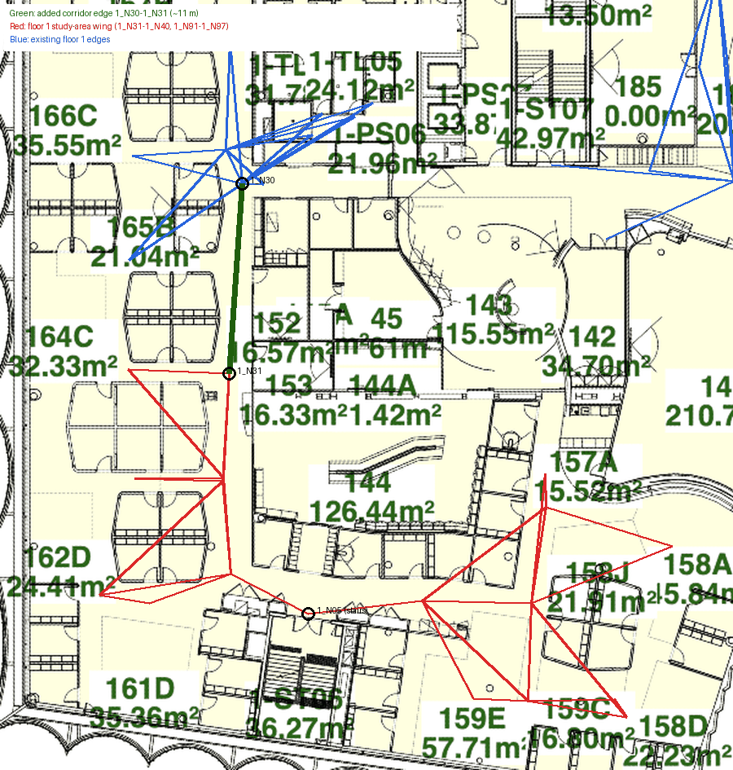
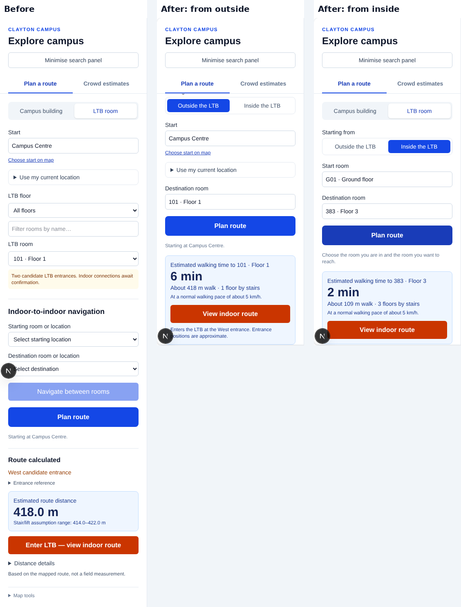
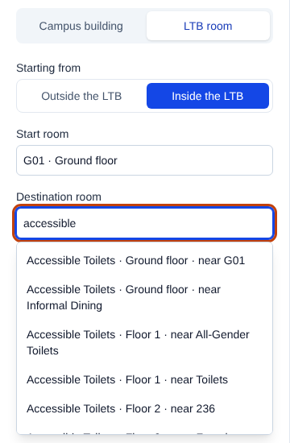
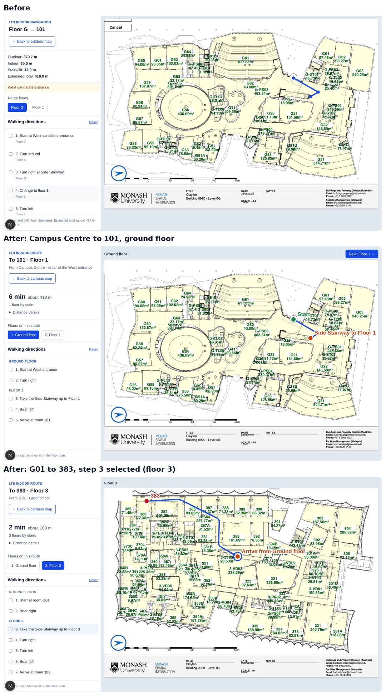

# Fix: LTB indoor routing and indoor navigation usability

Branch: `fix/ltb-cross-floor-edges` · Based on: `main` `4fa0dc8` · Date: 18–19 Oct 2026 · Author: Jiaqi
Status: **ready for review; not merged into `main`**. Jasleen owns the LTB indoor data and the indoor route view and should confirm before merging.

**Part A (routing data and tests)** fixes three problems:

| # | Problem | Fix |
|---|---|---|
| 1 | No indoor route can change floors (R2) | Restore 24 lift and stair edges and 2 room links that `2f8978d` dropped |
| 2 | Step-free routes cannot reach the floor 1 study area | Add the missing corridor link `1_N30–1_N31`, confirmed on the Level 1 floor plan |
| 3 | A Vitest suite (182 real-campus outdoor routes) fails to load | Mock the server-only walking preference in that test |

**Part B (indoor navigation usability, §8–§12)** makes the LTB room flow understandable on first use: one start, one destination, one "Plan route" button, plain-language results, and a floor plan that shows where to start, where to change floors and where to stop.

---

## 1. Problem: no indoor route can change floors

### What users see on `main` `4fa0dc8`

| Action in `/map` | Result |
|---|---|
| LTB room: start Campus Centre, destination **G01** (ground floor) | Works |
| LTB room: start Campus Centre, destination **101**, **231** or **383** (floors 1–3) | "No LTB route was found." |
| Indoor-to-indoor: **G01 → 101** | "No route is available for this walking preference…" |
| Same requests with the accessible walking preference | Same errors |

### Evidence

| Check | `e05c27c` (before) | `2f8978d` → `4fa0dc8` (now) |
|---|---|---|
| Edges in `api/ltb_edges.json` | 491 | 549 |
| Edges between different floors | **24** (6 lift, 18 stairs) | **0** |
| Connected components in the indoor graph | 1 | **8** |
| Rooms with no edges | none | `3_N37` (room 383), `3_N67` (room 303) |

### Root cause

`2f8978d` ("Indoor edges and graphs now smooth and cohesive", 14 Oct, 19:20) replaced `api/ltb_edges.json` with redrawn corridor edges, but the new file has no `vertical` edges. The 24 lift and stair links were lost, together with the only edges of rooms `3_N37` and `3_N67`.

`api/index.py` builds the indoor graph only from this file, so every floor became a separate island. The accessible graph is derived from the same file, so it failed too.

### Fix

The 26 edges are appended exactly as they were in `e05c27c`. All their end nodes still exist in the current `api/ltb_nodes.json`.

| Restored edges | Count | Details |
|---|---|---|
| Lifts | 6 | `G_N14–1_N01–2_N01–3_N01` and `G_N41–1_N02–2_N02–3_N02` |
| Stairs | 18 | Six stair cores: `G_N15/16/17/18/19/33` up through `1_N03…1_N08`, `2_N03…2_N08` and `3_N03…3_N08` |
| Room links | 2 | `3_N37–3_N23`, `3_N67–3_N17` (lengths measured from node coordinates by `api/indoor_distance.py`) |

No existing edge was removed or changed.

---

## 2. Problem: step-free routes cannot reach the floor 1 study area

### What we found

With the accessible walking preference (stairs removed), seven floor 1 "Study Area" rooms, `1_N91`–`1_N97`, could not be reached from either entrance.

Their wing (corridor nodes `1_N31`–`1_N40`) was linked to the rest of the building **only through `1_N05`, "External Stairs 1"**. So the data said "stairs only", even though the floor plan shows an open corridor.

This gap predates `2f8978d`; it also exists at `e05c27c`.

### Evidence from the Level 1 floor plan



`1_N30` (beside 165B/166C) and `1_N31` (beside 164C) sit on the same straight, open passage between the workstation pods and room 152. There is no wall or door between them, and they are 156 px apart (≈ 11 m at the plan's 14.2 px/m). The edge was simply never drawn.

### Fix

Add one corridor edge in the current format:

```json
{ "from": "1_N30", "to": "1_N31", "distance_pixels": 156.03 }
```

Effect, starting near Campus Centre (`/api/ltb-route`):

| Room | Normal | Accessible: before | Accessible: after |
|---|---|---|---|
| Study Area `1_N91` | 1 stair link, ≈ 474.6 m | unreachable | 1 lift link, ≈ 480.9 m |
| Study Area `1_N95` | 1 stair link, ≈ 475.7 m | unreachable | 1 lift link, ≈ 511.6 m |

---

## 3. Problem: the real-campus Vitest suite fails to load

`app/api/route/route.ts` now calls `getWalkingPreference()` (added with the wheelchair preference). That function imports `server-only` session code.

`lib/navigation/tests/route-api.test.ts` already mocks it; `lib/navigation/tests/campus-integration.test.ts` did not. As a result, Vitest stopped loading that file, so the 182-route NetworkX regression check was not running.

**Fix:** mock `@/lib/students/walking-preference` in that test with the guest default (`normal`, not personalised), the same way `route-api.test.ts` does. This is test setup only; runtime behaviour is unchanged.

---

## 4. Tests

- **New** `api/tests/test_ltb_graph_connectivity.py` (8 tests):
  - every pair of adjacent floors has a lift and a stair link;
  - the standard and the step-free graphs are each one connected building;
  - all 205 rooms are reachable from both entrances, with and without stairs;
  - the `1_N30–1_N31` link exists;
  - outdoor → floors 1/2/3 work for both preferences, and accessible routes use lifts and no stairs;
  - there is a step-free route to the study area;
  - an indoor-to-indoor route works from the ground floor to floor 3.
- **Updated** `api/tests/test_indoor_route_integration.py`: it reads the current `path` key (a list of node IDs) instead of the old `indoor_path`. The frontend already accepts `indoor_path`, `path` and `route`.
- **Updated** `lib/navigation/tests/campus-integration.test.ts`: walking-preference mock (§3).

## 5. Verification

| Suite | `main` `4fa0dc8` | This branch |
|---|---|---|
| Python routing tests (`test_ltb_connectors`, `test_indoor_distance`, `test_indoor_route_integration`, `test_route_privacy`, `test_pedestrian_graph`, and the new `test_ltb_graph_connectivity`) | 19 passed, 3 failed, 1 error (23 tests) | **31 passed** |
| Vitest (`npm test`) | 235 passed; 1 file fails to load | **420 passed, 27 files** |
| New connectivity tests against the unfixed edge file | — | Fail (12 failures), so the tests detect the defect |
| The same tests with only the `1_N30–1_N31` edge removed | — | 3 failures |

Routes from Campus Centre on this branch:

| Destination | Normal | Accessible |
|---|---|---|
| G01 (`G_N20`) | ≈ 396.9 m, same floor | ≈ 396.9 m |
| 101 (`1_N42`) | ≈ 418.0 m, 1 stair link | ≈ 473.4 m, 1 lift link |
| 231 (`2_N45`) | ≈ 458.8 m, 2 stair links | ≈ 465.0 m, 2 lift links |
| 383 (`3_N37`) | ≈ 474.9 m, 3 lift links (the lift is shorter here) | ≈ 474.9 m, 3 lift links |

Indoor-to-indoor G01 → 383: 11 nodes, 3 floor changes, ≈ 109.2 m.

Vertical travel uses the existing assumptions: 4.5 m per floor by lift and 12 m by stairs (README, "LTB indoor distance").

### How to check in the app

1. Restart the Python API, because JSON changes are not hot-reloaded: `python -m uvicorn api.index:app --reload --port 8000`. Then run `npm run dev`.
2. `/map` → **LTB room** → start Campus Centre → floor 1 → room **101** → Plan route. The route should open, and the floor plan should step from G to floor 1. Repeat for **231** and **383**.
3. Indoor-to-indoor **G01 → 101**.
4. Logged in with the accessible walking preference: the same routes use lifts, and a floor 1 "Study Area" room is reachable.

## 6. Not changed

- Corridor geometry and `distance_pixels` from `2f8978d` are kept.
- Part A changed no frontend, API or outdoor routing code. Part B changes the frontend (§11) and one Python error message. Routing logic is unchanged in both parts.
- No database change.

## 7. Questions for Jasleen before merging

1. Was removing the lift and stair edges in `2f8978d` intentional, for example with new connector positions planned?
2. Are the restored connector nodes (`G_N14`, `G_N41`, `G_N15`–`G_N19`, `G_N33` and their counterparts on floors 1–3) still placed correctly on the new floor plans?
3. Are `3_N37–3_N23`, `3_N67–3_N17` and the new `1_N30–1_N31` the right corridor links?
4. Part B rewrites the indoor route view and the room pickers in `components/Map.tsx` (§9–§10). Please check that nothing you are working on locally conflicts with it.
5. Can the four floor plans be exported again from MSIS without the print-dialog buttons (§10.4)?

---

# Part B: indoor navigation usability

## 8. How we found the problems

We ran the app locally and used `/map` as a first-time guest would, with two journeys: **Campus Centre → room 101** (start outside the LTB) and **G01 → 383** (start inside the LTB). We recorded every point where we did not know what to do next, or where the screen said something a student would not understand.

## 9. Problems found in the sidebar

| # | Problem | Why it matters |
|---|---|---|
| B1 | The "LTB room" tab held **two separate flows**: Start + LTB room, and an "Indoor-to-indoor navigation" block with its own two selects. | Two forms on one panel; users do not know which one to fill in. |
| B2 | **"Plan route" belonged to the first flow but sat below the second flow's "Navigate between rooms" button.** | It looked like a second button of the indoor-to-indoor block. |
| B3 | The "Start" field at the top had no effect on indoor-to-indoor routes. | Users filled in a field that was then ignored. |
| B4 | **Every route error was shown twice** (`routeError` was rendered at two places). | This is why "No LTB route was found." appeared twice. |
| B5 | Choosing a destination room took three controls (floor select, text filter, room select). The indoor-to-indoor selects listed all 205 rooms with internal IDs such as `(G_N61)`. | Slow to use; node IDs mean nothing to students. |
| B6 | An outdoor-start route showed only "418.0 m"; there was **no walking time**, unlike campus building routes. | Inconsistent with R1; time is what users want. |
| B7 | Developer wording: "Two candidate LTB entrances. Indoor connections await confirmation.", "West candidate entrance", "Entrance reference G_N01", "Stair/lift assumption range". | Reads like debug output. |
| B8 | The result appeared below the fold (at a 900 px window height we had to scroll to find "Enter LTB"). Indoor-to-indoor jumped straight into the indoor view, but outdoor-start did not. | Two different behaviours for the same kind of action. |
| B9 | State leaked between flows: after an indoor-to-indoor route, an outdoor-start route still showed "From G01 to 383" in its title; the indoor-to-indoor result kept the previous "West candidate entrance"; walking directions from an earlier campus-building route stayed visible after switching to "LTB room"; ticked indoor steps stayed ticked for a new route. | Users see information from an older route. |
| B10 | Indoor-to-indoor routes said "Distance details are unavailable" although `/api/indoor-route` returns the distances. | The frontend never stored them. |

## 10. Problems found in the indoor route view

| # | Problem |
|---|---|
| B11 | The title "Floor G → 101" changed whenever another floor was selected, so it read as "from floor G". |
| B12 | All route points were identical blue dots; nothing showed the start, the destination, or where to take the stairs or lift. |
| B13 | Directions said "Turn around" for an ordinary sharp turn (any turn over 90°), e.g. step 2 from the west entrance. |
| B14 | A floor change said only "Change to floor 1", without stairs or lift; a lift ride from G to 3 gave three separate "Change to floor …" steps. Every unnamed corridor point produced a "Continue straight" step. |
| B15 | Floors passed inside a lift or stairwell (e.g. floors 1 and 2 on a lift ride to 3) got their own floor buttons, showing a plan with a single dot. |
| B16 | Selecting a step did nothing; users had to match steps to floors themselves. |
| B17 | All four floor-plan images (`public/ltb/Floor-*.png`, same as `LTB_indoor_graph/floorplans/`) contain **"Print" and "Cancel" buttons** in the top-left corner, captured from a print dialog. |
| B18 | Footer text "0–50 m scale bar (14.2 pixels per metre)". |

## 11. What we changed



### 11.1 One flow in the sidebar (B1–B3, B5, B8)

- The "LTB room" tab now asks **"Starting from: Outside the LTB / Inside the LTB"**.
  - **Outside** shows the existing Start controls (building search, map point, current location).
  - **Inside** replaces them with a **Start room** search.
- **Destination room** is one searchable box (the existing accessible `BuildingSearch` combobox, made generic with `noun="room"`). Typing "101", "toilet" or "floor 3" filters the list.
- There is **one "Plan route" button**, placed directly under the inputs. It calls `/api/route`, `/api/ltb-route` or `/api/indoor-route` depending on the tab and the start type, and is enabled only when the chosen journey is complete.
- The separate "Indoor-to-indoor navigation" block and the "Navigate between rooms" button are removed.
- Both LTB journeys now end the same way: a result card that scrolls into view, with a **View indoor route** button.

### 11.2 Room names without node IDs (B5)

`roomOptions()` (new, `lib/navigation/indoor.ts`) labels rooms as "101 · Floor 1". Shared names get the closest uniquely named room on the same floor, and a number when that is still not unique:



- "Accessible Toilets · Ground floor · near Informal Dining"
- "Study Area · Floor 1 · near 101 (2)" (the plans have 100 rooms called "Study Area")

Every one of the 205 labels is unique and none contains a node ID (tested).

### 11.3 Results in plain language (B4, B6, B7, B10)

- Errors are rendered once.
- The result card shows **walking time first**, at the student's pace ("6 min"), then "About 418 m walk · 1 floor by stairs". Logged-in students with the Accessible preference also see "Step-free route: lifts only, no stairs."
- "West candidate entrance" → "West entrance". The entrance reference, the "Two candidate LTB entrances…" banner and the "assumption range" line are removed. Because the entrance pairing is still unverified (`mapping_verified: false`), the card keeps one honest line: "Enters the LTB at the West entrance. Entrance positions are approximate."
- Room-to-room routes now show their time and distance. `summariseIndoorRoute()` reads either response shape.
- The Python error "No valid indoor route exists. The same-floor corridor graph may have a missing connection." (shown even for cross-floor requests) is now "No indoor route is available between these rooms." (with "without stairs" for the accessible profile).

### 11.4 No leaked state (B9)

`invalidateRoutes()` now also clears outdoor directions, the indoor summary, the trip title, the selected step and ticked steps. The indoor view takes its title from the trip saved with each result, not from whichever select was last touched.

### 11.5 Indoor route view (B11–B18)



- **Title:** "To 101 · Floor 1", with "From Campus Centre · enter at the West entrance" (or "From G01 · Ground floor").
- **Summary:** time, distance and floor changes; the outdoor / indoor / stairs-and-lifts split is under "Distance details".
- **Markers:** green **Start**; red destination with the room name; orange **"Side Stairway to Floor 1"** where the route leaves a floor (clickable), and **"Arrive from Ground floor"** where it continues. The extra blue dots are gone; the line is unchanged.
- **Floors:** only floors where the user walks are listed, numbered in route order ("1. Ground floor", "2. Floor 3"). A **"Next: Floor 3 →"** button sits above the plan.
- **Directions** (`makeIndoorDirections()`, moved to `lib/navigation/indoor.ts` and rewritten):
  - grouped under floor headings;
  - turns are "Bear" (25–50°), "Turn" (50–135°), "Turn sharp" (135–165°) and only "Turn around" above 165°;
  - a run of floor changes becomes one step naming the connector: "Take the External Lift up to Floor 3";
  - unnamed straight corridor points are skipped; named ones become "Continue past …";
  - room numbers read as "Arrive at room 383".
- **Selecting a step** switches to its floor and circles that point on the plan.
- **Print-dialog buttons (B17):** the view draws a white rectangle over that corner (178 × 84 px of the 1722 × 1188 image). On the ground floor nothing else is there. On floors 1–3 it also hides a small part of the building's top-left outer wall. We tried cleaning the PNG pixels instead, but the buttons overlap thin anti-aliased wall lines and the result was worse. A clean export from MSIS is the proper fix (question 5).
- The developer footer is replaced by "Select a step to show it on the floor plan."
- On narrow screens the sidebar now stacks above the floor plan instead of taking half the width.

### 11.6 Other

- `prefer-const` lint error in `makeOutdoorDirections` (`groupBearing`) fixed; `npx eslint .` is now clean.
- `makeOutdoorDirections` takes an optional destination name, so the outdoor part of an LTB route ends with "Continue to the LTB West entrance".

## 12. Tests and verification for Part B

- **New** `lib/navigation/tests/indoor.test.ts` (13 tests):
  - left/right, bear, sharp-turn and U-turn wording;
  - the real 101 route gives "Take the Side Stairway up to Floor 1" and no "Turn around";
  - a G→3 lift ride gives one "Take the External Lift up to Floor 3" step;
  - "candidate" wording is hidden;
  - all 205 room labels are unique and contain no node IDs;
  - both response shapes are summarised.
- Results:

| Check | Result |
|---|---|
| Vitest (`npm test`) | **433 passed, 28 files** |
| Python routing tests (as in §5) | **31 passed** |
| `npx tsc --noEmit` | passes |
| `npx eslint .` | no problems (was 1 error on `main`) |

- Manual run in Chromium (1440 × 900 and 390 × 844), local Python API and `next dev`:
  - Campus Centre → 101;
  - G01 → 383, then step 3 selected;
  - room search for "accessible";
  - switching between campus building, outside start and inside start, checking that nothing from the previous route stays.
- **Not covered here:** the logged-in Accessible preference path (needs the database). The step-free routes themselves are covered by the Python tests in §4.

### How to check in the app

1. Restart the Python API and `npm run dev`, as in §5.
2. `/map` → **LTB room** → **Outside the LTB** → Start "Campus Centre" → Destination room "101" → **Plan route**. Check the result card, then **View indoor route** → **Next: Floor 1 →**.
3. **Inside the LTB** → Start room "G01" → Destination room "383" → **Plan route** → **View indoor route**. Select "Take the Side Stairway up to Floor 3".
4. Destination room: type "accessible" and check that the toilets are told apart by floor and a nearby room.
